<a href="https://harsha-reddy.vercel.app/">
  
</a>

  
  
  
  
  

<picture>
  <source media="(prefers-color-scheme: dark)" srcset="assets/h-about.svg">
  
</picture>

<h3 align="center">I don't just train models. I build the pipes that feed them and the systems that keep them running.</h3>


<b>Read the model card as plain text</b>

 

**Who:** Harshavardhan Reddy, AI Engineer at [Yukty AI](https://yukty.com/), from Kadapa, Andhra Pradesh, India.

**Working at:** Yukty AI as an AI Engineer, building AI agents, automation and data pipelines.

**Trained on:** B.Tech in Computer Science (AI & Data Engineering) at Lovely Professional University, 2023 to now. AI & Data Engineering intern at Futurense Technologies, June to August 2025. Certified in Microsoft Azure Data Fundamentals, Supervised Machine Learning (Coursera) and Generative AI with LLMs.

**What I do:** take messy, raw data, make it clean and reliable, and turn it into AI that does real work without anyone pushing buttons.

**Running now:**
1. **Truxlo:** an AI logistics platform that plans truck routes and forecasts demand
2. **Social autopilot:** writes, fact-checks and posts one LinkedIn and X post a day
3. **JARVIS (MARK XL):** a voice assistant that runs fully on my own computer
4. **AURA:** a personal AI that remembers decisions and why they were made
5. **Learning:** generative AI, every day

**Results so far:** 30% faster data processing at Futurense · 0.41 ROUGE-L on medical report summaries · 8 quality gates before any automated post goes out · 25+ AI news feeds read every week · 0 cloud calls for JARVIS · 40% better fleet tracking in Truxlo.

<picture>
  <source media="(prefers-color-scheme: dark)" srcset="assets/h-workflow.svg">
  
</picture>


The first three steps are **data engineering**: getting data in and making it trustworthy. The last two are **AI engineering**: making it smart and putting it to work. Then I watch how it does and improve it.

<picture>
  <source media="(prefers-color-scheme: dark)" srcset="assets/h-projects.svg">
  
</picture>

  <a href="https://github.com/harsha3358/Aura"></a>
  
  
  <a href="https://ai-weekly-monitor.vercel.app"></a>
  <a href="https://github.com/harsha3358/weather_api_pipeline"></a>
  <a href="https://github.com/harsha3358/RAG-without-framework"></a>
  <a href="https://github.com/harsha3358/Medical_Report_Summarizer_with_Clinical_NER"></a>
  <a href="https://reel-register.vercel.app/"></a>

<b>More projects</b> (click to open)

 

| Project | What it does | Type |
| :-- | :-- | :-- |
| [AI LinkedIn Automation](https://github.com/harsha3358/ai-linkedin-automation) | Finds AI news, drafts posts with several AI reviewers, makes images, schedules them | AI agents |
| [Naukri Job Automation](https://github.com/harsha3358/Naukri_job_automation) | Finds jobs that fit you, applies within a daily limit, logs each one in Google Sheets | Automation |
| [Text-to-SQL Engine](https://github.com/harsha3358/Text_to_sql_engine) | Turns plain English questions into SQL and shows the results | Data |
| [Tech Intelligence Monitor](https://github.com/harsha3358/slm_model_fetching_real_data) | Pulls arXiv papers and news, removes duplicates, ranks what matters | Data + NLP |
| [AutoRubric AI](https://github.com/harsha3358/autorubric_aii) | Scores student answers and gives written feedback | Generative AI |
| [SmartScore ML](https://github.com/harsha3358/SmartScore_ml) | Predicts exam scores; trained, containerised and deployed on AWS | Machine learning |
| [Fast Local Image Generation](https://github.com/harsha3358/Image-Video-generation-) | Turns text into images on your own GPU with Stable Diffusion Turbo | Generative AI |
| [VOLTIDE](https://voltide.vercel.app/) | A game-style cloud computing course for first-year students | Teaching tool |

<picture>
  <source media="(prefers-color-scheme: dark)" srcset="assets/h-stack.svg">
  
</picture>

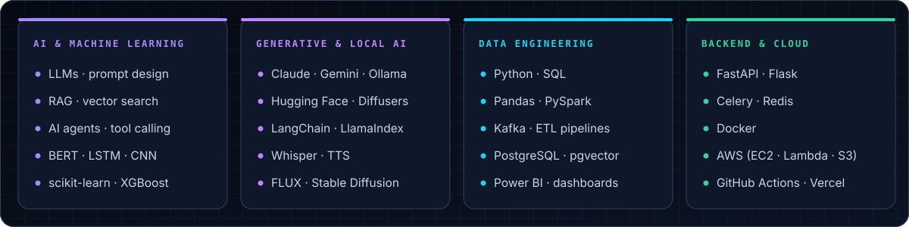


<picture>
  <source media="(prefers-color-scheme: dark)" srcset="assets/h-stats.svg">
  
</picture>


<picture>
  <source media="(prefers-color-scheme: dark)" srcset="https://raw.githubusercontent.com/harsha3358/harsha3358/output/github-contribution-grid-snake-dark.svg">
  
</picture>

<picture>
  <source media="(prefers-color-scheme: dark)" srcset="assets/h-contact.svg">
  
</picture>

I'm an **AI Engineer at [Yukty AI](https://yukty.com/)**. Want to build something with AI or data? I'm up for collaborations, side projects and good conversations. Email or LinkedIn reaches me fastest.

  
  

